<p align="center">
  
</p>

<h1 align="center">rabmin</h1>

<p align="center">
  A modern management UI and HTTP API for <a href="https://www.rabbitmq.com">RabbitMQ</a>.<br>
  Many clusters in one place, the messaging topology at a glance, safe message browsing, and cluster maintenance as a workflow.
</p>

<p align="center">
  <a href="https://github.com/wankdanker/rabmin/actions/workflows/ci.yml"></a>
  <a href="https://github.com/wankdanker/rabmin/releases/latest"></a>
  <a href="https://github.com/wankdanker/rabmin/pkgs/container/rabmin"></a>
  <a href="https://goreportcard.com/report/github.com/wankdanker/rabmin"></a>
  <a href="LICENSE"></a>
</p>

<p align="center">
  <picture>
    <source media="(prefers-color-scheme: dark)" srcset="docs/screenshots/overview-dark.png">
    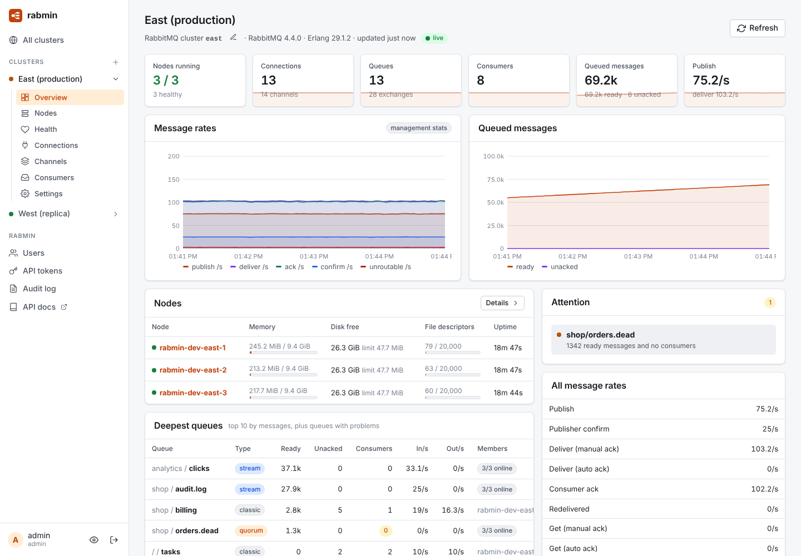
  </picture>
</p>

> **Status: early development.** rabmin observes clusters today (phase 1 of the [roadmap](ROADMAP.md)): fleet and cluster overviews, nodes, a health matrix, connections, channels and consumers. Managing queues, exchanges, users and policies comes next.

rabmin is one Go binary with the UI built in, the sibling of [natsmin](https://github.com/wankdanker/natsmin). It talks to RabbitMQ through the management HTTP API and the Prometheus endpoint (and, in later phases, AMQP and stream clients). Nothing is installed on your brokers.

## What it does today

**Many clusters in one place**
- A fleet page with the health, versions, nodes, connections, queued messages and rates of every registered cluster
- Register a cluster by its management URLs, ideally one per node: rabmin fails over between them, and a connection test reports the RabbitMQ and Erlang versions, enabled plugins, the user's tags, and which nodes each URL reaches

**See each cluster**
- Live overview over server-sent events: nodes, connections, channels, queues, consumers, queued messages, every message rate the management UI shows (publish, confirm, deliver with manual and automatic ack, get, get-empty, ack, redeliver, returned and dropped unroutable, disk reads and writes) and churn
- Rates come from the management statistics database, or from rabmin's own Prometheus counter deltas when the stats database is disabled, as RabbitMQ 4.x encourages
- An attention list: nodes down, memory and disk alarms, partitions, maintenance mode, mixed versions, failing health checks, unreachable endpoints, quorum queues with members offline, and deep queues nobody consumes
- Nodes with memory, disk, file descriptors, Erlang processes and uptime; node detail with the memory breakdown, plugins and the raw management object; reset statistics
- A health matrix that runs RabbitMQ's node-local health checks (`alarms`, `local-alarms`, `virtual-hosts`, `is-in-service`, `ready-to-serve-clients`, `below-node-connection-limit`, `node-is-quorum-critical`, `certificate-expiration`, protocol listeners) through each node's own management URL
- Listening ports and web contexts; rename the RabbitMQ cluster

**Clients**
- Connections (AMQP 0-9-1, AMQP 1.0, MQTT, STOMP and direct) filtered by client name, user, vhost, node or protocol, sorted by traffic, with client properties, TLS and negotiated limits; stream protocol connections
- Close a connection with a reason sent to the client, or close many by user, vhost or client name behind type-to-confirm
- Channels with prefetch, unacked and unconfirmed counts and saturation flagged; consumers with ack mode, prefetch and single-active-consumer state

**Manage objects**
- Virtual hosts with description, tags, default queue type, connection and queue limits, deletion protection, and restarting a vhost that failed on a node
- Exchanges with their bindings in both directions; add and remove bindings, including to other exchanges
- Queues and streams filtered by vhost, name, regex, type, state or policy, with a column chooser; create classic, quorum and stream queues with helpers for every argument; purge and delete behind type-to-confirm, optionally only if empty or unused
- Publish a message to any exchange or straight to a queue, with properties, headers and a base64 payload, and see whether it was routed
- RabbitMQ users with tags, permissions, topic permissions and user limits; changing tags keeps the password
- Policies and operator policies with a form or JSON editor and a live preview of which queues and exchanges a pattern matches and whether the policy would win
- Vhost and global parameters (federation upstreams, shovels and others; passwords in URIs are masked) and cluster tags
- Definitions export for the cluster or one vhost, and import that shows what a file would add, change or skip as a conflict, then imports only what you pick
- Feature flags with one-click enabling of stable flags, and deprecated features flagged when in use

**Built for teams**
- Users with viewer, operator and admin roles; API tokens limited to a role and expiry
- An audit log of every change, through the UI or the API
- RabbitMQ credentials and TLS keys are encrypted at rest; extra credential profiles let later features run as less privileged users

**API plane**

Everything the UI does is a documented HTTP API: OpenAPI 3.1 at `/api/openapi.json`, interactive docs at `/api/docs`. The UI is just one client.

```bash
curl -H "Authorization: Bearer rm_..." http://localhost:8080/api/v1/clusters/prod/connections?q=billing
```

## Screenshots

| | |
|---|---|
| 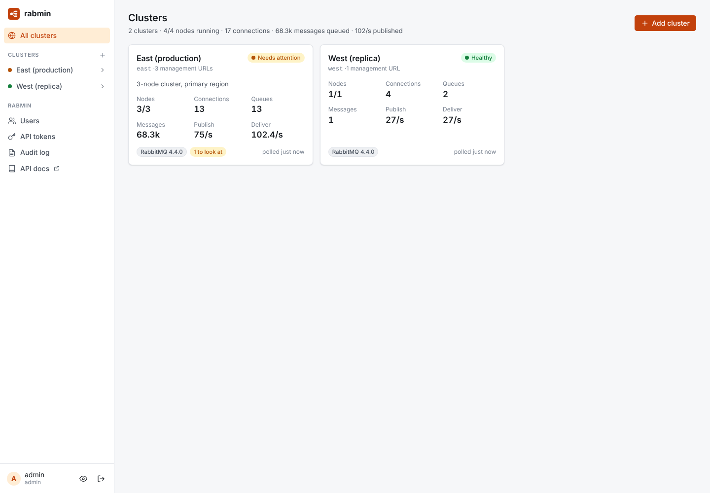 **Clusters:** every cluster at a glance | 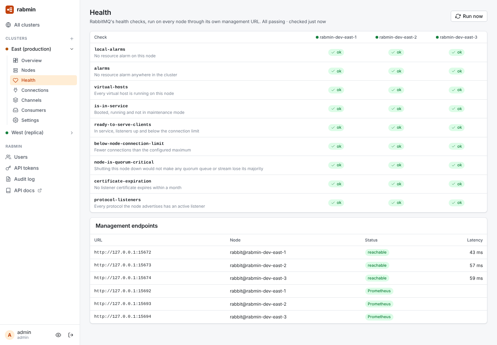 **Health matrix:** RabbitMQ's checks on every node |
| 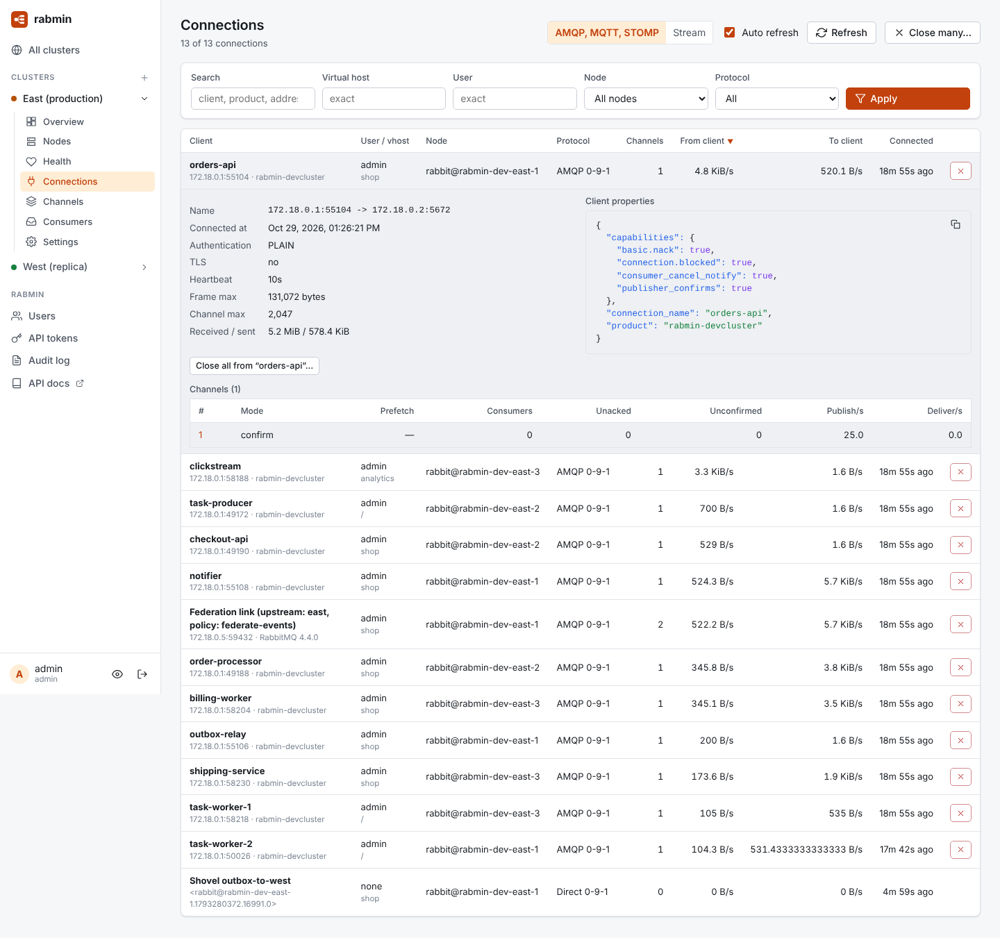 **Connections:** filter, inspect and close | 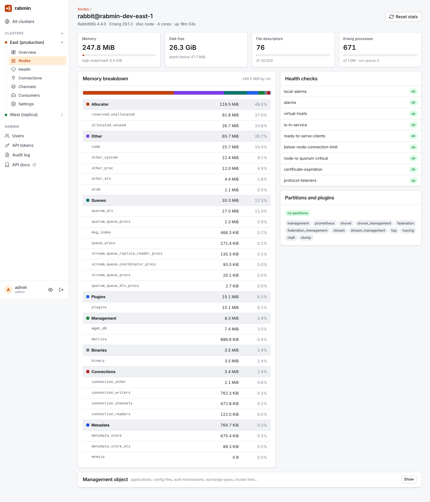 **Node detail:** memory breakdown, checks and plugins |
| 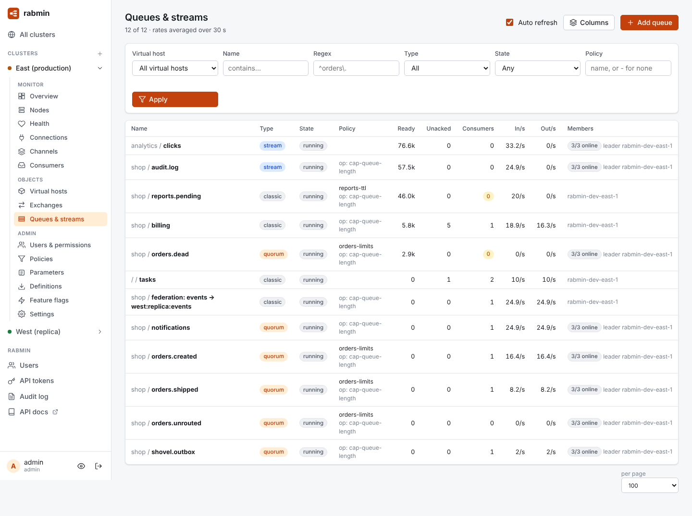 **Queues and streams:** filter, choose columns, create | 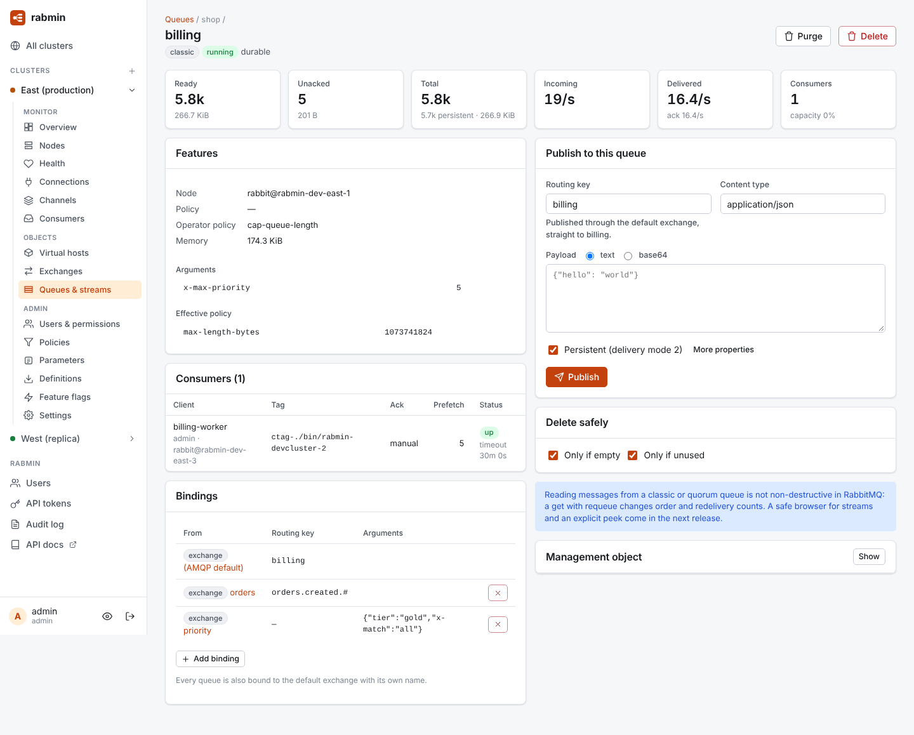 **Queue detail:** members, consumers, bindings, publish |
| 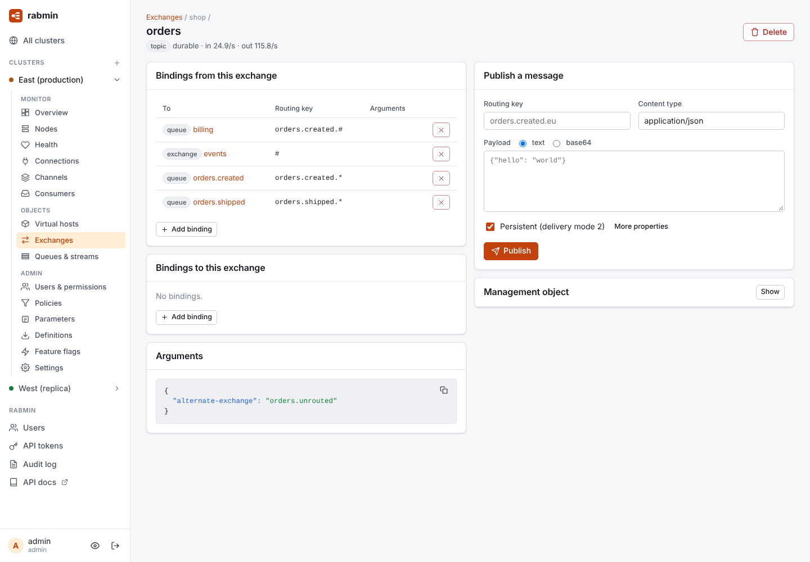 **Exchange:** bindings both ways and publish | 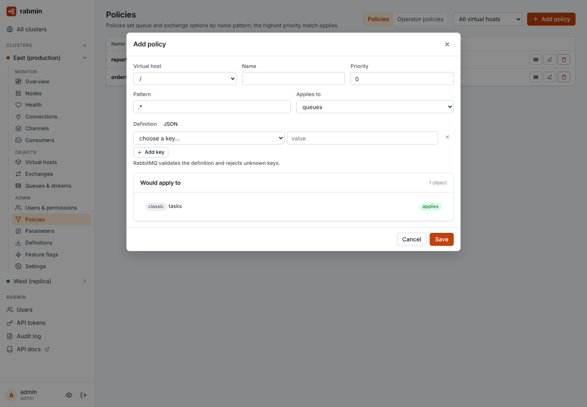 **Policies:** see what a pattern matches before saving |
| 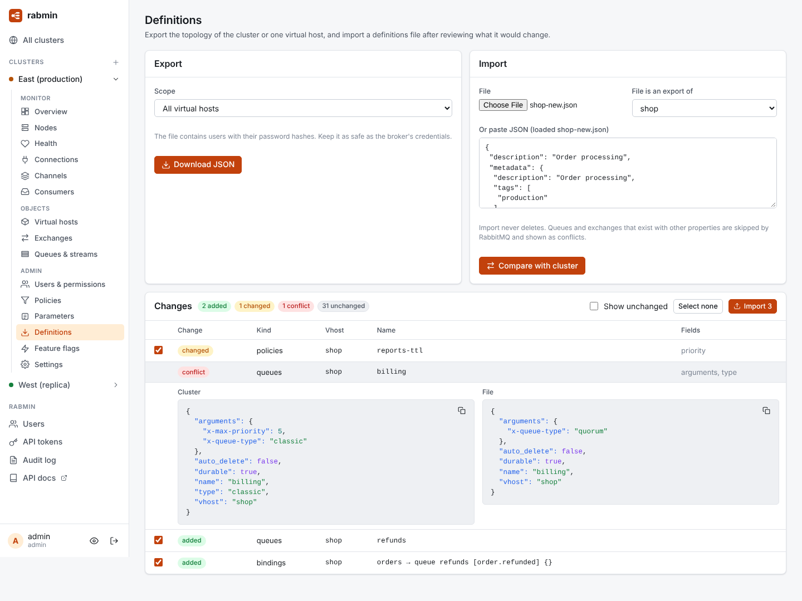 **Definitions:** review an import before running it | 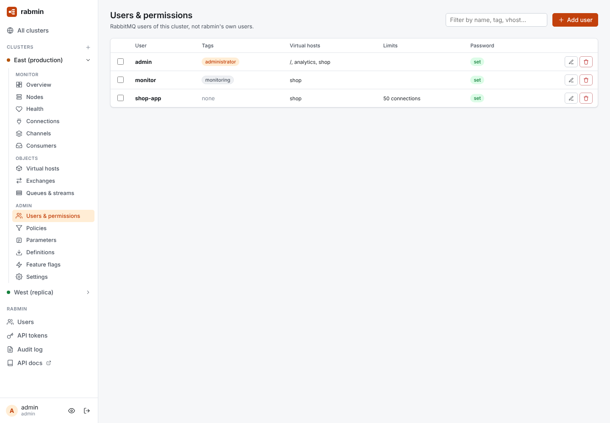 **RabbitMQ users:** tags, vhosts and limits |

## Where it is going

- Everything the built-in management UI does, in a more modern form.
- Many clusters in one place, with a fleet overview and cross-cluster search.
- A topology map of exchanges, bindings and queues, and a "where does this message go?" simulator.
- Safe message browsing: streams read non-destructively, and classic and quorum queues browsed with explicit requeue semantics.
- Maintenance as a workflow: pre-checks, drain, upgrade, revive, node by node.
- An API plane: every UI action is a documented API operation.

Next up is phase 2: vhosts, exchanges, queues, bindings, users, permissions, policies and definitions. Every planned item is a [GitHub issue](https://github.com/wankdanker/rabmin/issues?q=is%3Aissue+is%3Aopen+label%3Aroadmap); [ROADMAP.md](ROADMAP.md) has the overview.

## Install

**Docker**

```bash
docker run -p 8080:8080 -v rabmin:/data ghcr.io/wankdanker/rabmin
```

**From source**

```bash
make ui build && ./bin/rabmin
```

Open http://localhost:8080, create the admin account, then add a cluster:

- **Management URLs**: `http://host:15672`, one per node if you can.
- **Credentials**: a RabbitMQ user tagged `monitoring` is enough to observe; `administrator` is needed for changes. OAuth2 bearer tokens work for brokers whose management API uses OAuth2.
- **Prometheus URLs** (optional): `http://host:15692`, one per node, for rates when the management stats database is disabled.

RabbitMQ 3.13 and later are supported; 4.x is the main target.

## Try it with local RabbitMQ clusters

`rabmin-devcluster` starts a 3-node RabbitMQ 4.x cluster `east` and a single-node cluster `west` in Docker, joined by a federation link and a shovel, and can seed vhosts, queues of every type, policies and demo traffic.

```bash
go run ./cmd/rabmin-devcluster --demo
```

Management APIs are on http://localhost:15672 to 15675 (user `admin` / `admin`, or `monitor` / `monitor`), Prometheus on 15692 to 15695, AMQP on 5672 to 5675. Register `east` with the first three management and Prometheus URLs, and `west` with the fourth. Stop with ctrl-c, or `go run ./cmd/rabmin-devcluster --down` after an interrupted run.

Or with Docker Compose (3-node cluster plus rabmin, login `admin` / `changeme`):

```bash
docker compose up --build
```

## Configuration

rabmin's command line is built with [clyops](https://clyops.io). Every option can also be set with the environment variable of the same row; the command line wins.

| Option | Variable | Default | |
|---|---|---|---|
| `--addr` | `RABMIN_ADDR` | `:8080` | Listen address |
| `--data` | `RABMIN_DATA` | `./data` | Database and secret key directory |
| `--secret-key` | `RABMIN_SECRET_KEY` | | Base64 32-byte key for encrypting credentials. If unset, one is generated in the data directory. Prefer the variable: secrets on a command line are visible in `ps`. |
| `--admin-user`, `--admin-password` | `RABMIN_ADMIN_USER`, `RABMIN_ADMIN_PASSWORD` | | Create the first admin on startup |
| `--allow-setup` | `RABMIN_ALLOW_SETUP` | `true` | Let the first visitor create the admin when no users exist. Turn off when exposing rabmin before setup. |
| `--poll` | `RABMIN_POLL_INTERVAL` | `5s` | How often each cluster is polled |
| `--secure-cookies` | `RABMIN_SECURE_COOKIES` | `false` | Mark session cookies `Secure` (enable behind HTTPS) |
| `--tls-cert`, `--tls-key` | `RABMIN_TLS_CERT`, `RABMIN_TLS_KEY` | | Serve HTTPS directly |
| `--log-json` | `RABMIN_LOG_JSON` | `false` | JSON logs |

`rabmin` with no command serves; `rabmin openapi` prints the OpenAPI document and `rabmin version` the version. `rabmin --help-json-schema` describes the whole command line as JSON, and `rabmin --completion bash` (or `zsh`, `fish`) prints a completion script.

## Roles

| | viewer | operator | admin |
|---|:-:|:-:|:-:|
| See everything | ✓ | ✓ | ✓ |
| Queues, exchanges, bindings, messages; close connections | | ✓ | ✓ |
| Register clusters, RabbitMQ users, permissions and policies, maintenance, rabmin users, audit log | | | ✓ |

## Development

Requirements: Go 1.26+, Node 22+, pnpm and Docker.

```bash
make devcluster   # terminal 1: RabbitMQ clusters + demo traffic
make dev          # terminal 2: API server on :8080
cd ui && pnpm install && pnpm dev   # terminal 3: UI with hot reload on :5173
```

`make test` runs the Go tests; integration tests start RabbitMQ clusters in Docker and skip without a daemon. `make check` runs vet, gofmt and the Svelte type checker. After changing the API, `make openapi` regenerates `docs/openapi.json` and the UI's typed client.

See [docs/architecture.md](docs/architecture.md) for how the pieces fit together, [CONTRIBUTING.md](CONTRIBUTING.md) for the workflow, and [RELEASING.md](RELEASING.md) for cutting releases.

## License

Apache License 2.0. RabbitMQ is a trademark of Broadcom. rabmin is an independent project and is not affiliated with Broadcom or the RabbitMQ team.
